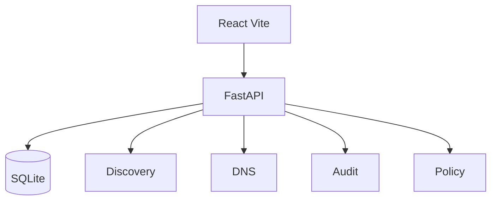

# Netra Architecture



Components: frontend dashboard, backend API, SQLite persistence, discovery, DNS analytics, audit, policy planning, snapshots, recovery.
```
/home/meghana/Documents/viswam/Netra/docs/INSTALLATION.md