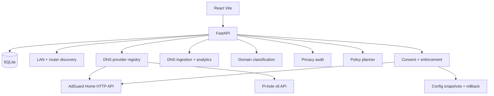

# Netra Architecture

## Live inventory and DNS identity

A successful LAN scan replaces the current process snapshot for its selected
subnet and marks observed persistent rows current. Unobserved rows in the same
subnet remain in SQLite as historical records and are not marked offline by
timeouts or partial scans. The `devices` table is upgraded additively with
`is_current`, `network_subnet`, `last_scan_at`, and `scan_status`; no historical
rows are deleted. MAC address is the preferred stable identifier, while IP
address is used for verified DHCP/DNS association and fallback matching.

AdGuard query-log synchronization persists real provider events. Each event
stores provider provenance, client IP/name, timestamp, category and blocked
status. Ingestion links by exact client IP, then hostname when no IP match exists;
it never invents a domain or device identity. Missing provider configuration,
provider disconnection, and unlinked events are separate UI states.

## LAN Discovery flow

`POST /api/discovery/run` validates the requested private subnet against the
active interface or `NETRA_AUTHORIZED_CIDRS` before launching probes. The
scanner selects at most 64 hosts and submits them to a worker pool capped at
eight threads. Each ICMP subprocess is bounded to 1.25 seconds, and all probe
work shares a 12-second monotonic deadline. Pending work is cancelled when the
deadline expires; observations completed before then are retained and marked
partial.

Before probing, the backend snapshots complete Linux ARP entries. After probing
it reports successful ICMP responders and neighbor entries that appeared or
changed during the scan. An unchanged cached entry alone is not a new
discovery. MAC addresses are retained only from complete neighbor entries;
hostnames are not looked up in API scans, and vendors are never inferred from
MAC prefixes. The route persists observations through the existing inventory
upsert and returns duration, attempted probes, responding hosts, timeout and
error counts, and the partial-result flag. The frontend displays those results
and refreshes both the in-memory scan results and persistent device inventory.

## DNS data flow (Milestone 9.0)

1. `dns/providers/registry.py` selects a provider from environment configuration.
2. `AdGuardHomeAdapter` authenticates with HTTP Basic auth and calls the
   supported `/control/status`, `/control/querylog`, `/control/stats`, and
   `/control/filtering/*` endpoints with bounded timeouts. `PiHoleAdapter`
   preserves compatibility with `NETRA_PIHOLE_URL` / `NETRA_PIHOLE_TOKEN`.
3. `POST /api/dns/events/sync` fetches a bounded, newest-first query log page
   set, normalizes timestamps/domains/clients, and stores rows idempotently via
   `(source, source_event_id)`.
4. `dns/analytics.py` classifies domains with conservative suffix rules and
   computes totals, unique domains, blocked/allowed counts, category and client
   distributions, top domains, and hourly activity from stored events.
5. Audit findings feed the dry-run planner. Nothing is applied until approval
   with `confirm=true` **and** `NETRA_DNS_ENFORCEMENT_ENABLED=true`. Applied
   user rules are snapshotted so rollback restores the exact prior rule list.

Provider health is derived from real API calls. A running FastAPI process is
never reported as a healthy DNS provider. Secrets stay in environment
variables and are absent from API responses, logs, and status payloads.

Components: frontend dashboard, backend API, SQLite persistence, discovery,
DNS provider adapters, DNS analytics, audit, policy planning, consent-gated
enforcement, snapshots, and recovery.
